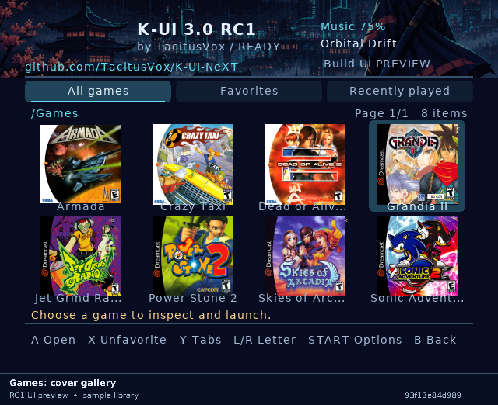
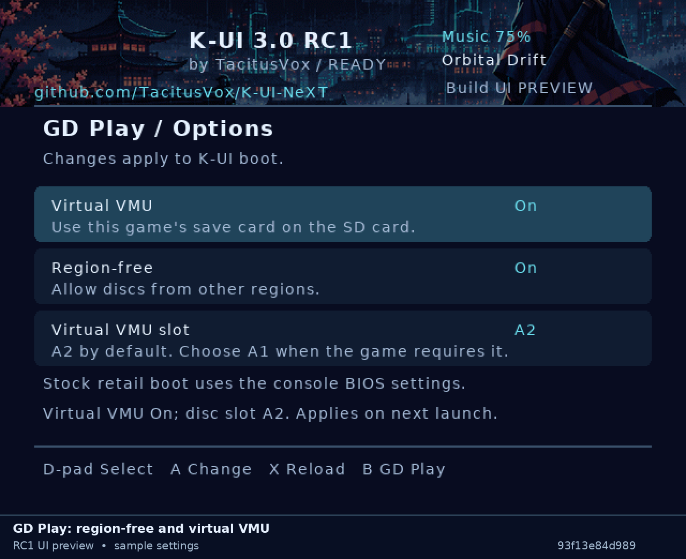

# K-UI for Dreamcast

**K-UI is a free, open-source menu and toolkit that runs on a Sega Dreamcast.**
Use it to play compatible games from SD, launch original game discs, manage
memory-card saves, and copy or recover your own discs. Its game browser adds
cover art, search, favorites, manuals and optional video previews.

The main supported setup keeps the **original disc drive (GD-ROM)** and adds a
**compatible SD adapter**. A K-UI boot CD starts the console and loads the menu
from that SD card. Normal installation does not require flashing the BIOS.

**[Start here: install and use K-UI](docs/getting-started.md)** ·
**[Download 3.0 RC1](https://github.com/TacitusVox/K-UI-NeXT/releases/tag/v3.0.0-rc.1)** ·
**[Hardware, GDEMU and VMU questions](docs/hardware-and-compatibility.md)**

This page describes **3.0 RC1 “Muramasa,” a release candidate**. The previous
stable release is [2.0.0 “Tyrfing”](https://github.com/TacitusVox/K-UI-NeXT/releases/tag/v2.0.0).
New users should download **`kui-3.0.0-rc.1-sd.zip`** from the RC1 release's
**Assets** section. It contains the ready-to-use software and boot-disc image.

## What can I do with it?

| I want to… | What K-UI provides |
| --- | --- |
| **Keep playing my original discs** | **GD Play** launches supported original-disc games, with optional region-free boot. Supported native games can also save to a virtual VMU on SCI storage while the game runs from the disc. |
| **Play compatible games from SD** | The **Games** launcher opens supported disc-image formats. Native Dreamcast, Windows CE and Sega Smash Pack paths are included; compatibility and optional features depend on the game and storage hardware. |
| **Manage or back up my saves** | Back up physical VMUs, browse and restore supported save backups, import saves, and keep separate software virtual cards for supported games or playthroughs. |
| **Browse a larger collection comfortably** | Cover-art Gallery and Flow views, search, Favorites, Recently played and grouped multi-disc entries. With supported networking, download covers, manuals and optional gameplay clips directly on the console. |
| **Copy or recover my discs** | Rip to SD, verify saved data, resume interrupted jobs, and retry unreadable sectors using the damaged-disc recovery tools. |
| **Use the Dreamcast's other tools** | Manage files, play music, transfer files over supported networking, change themes and colors, capture menu screenshots, and install K-UI software updates. |

Virtual VMU support, CD music and smooth movie playback are still
game-dependent. “Universal Loader” is the project's common-launcher effort,
not a promise that every game and every option already work.
[RC1 changes and tested results](docs/changelog-v2.0.0-to-v3.0.0-rc.1.md).

## Will it work with my setup?

**The location of the SD card matters.** These devices are not the same storage
connection:

| Your setup | What to expect |
| --- | --- |
| **Original drive + an SD adapter in the rear serial port** | This is **SCIF** storage. It supports the K-UI menu, disc and save tools, and supported native Standard game loading. It does not enable all SCI-only game features. |
| **Original drive + an internally wired SCI microSD adapter** | This is **SCI** storage. It is the required connection for the current Background, Windows CE and software virtual-VMU routes. It requires a hardware modification. Individual game support still varies. |
| **GDEMU or another optical-drive emulator** | **Not officially supported.** K-UI currently has no integration to browse or switch GDEMU's game-image slots. The SD inside an ODE is not mounted as K-UI's SD storage. Booting K-UI through an ODE would be a separate, unvalidated setup. |
| **An original or replacement controller-slot memory card** | Physical memory cards and K-UI's software virtual VMU are separate. K-UI uses normal Dreamcast memory-card operations, but **VM2, VMUPro and other third-party devices do not have a validated compatibility claim here**, including automatic card switching. |
| **IDE/CF storage modification** | Experimental implementation; hardware validation remains outstanding. |

**A K-UI virtual VMU is a save file on K-UI's SD card, presented to a supported
game as a memory card.** It does not require a VM2 or VMUPro. Normal virtual
cards have 200 user blocks; multiple cards can be kept. A physical card can
still be used with K-UI's Virtual VMU option off.

[Read the hardware and compatibility FAQ](docs/hardware-and-compatibility.md)
for the GDEMU distinction, replacement VMUs, A1/A2 slots and networking choices.

## See the interface

| Browse a collection | Play a disc with optional services |
| --- | --- |
|  |  |

These are **RC1 UI previews rendered by the released interface code with sample
data**, using the shipped Muramasa theme. They illustrate the interface, not
game compatibility test results.
[More feature images](resources/Share-1280/Feature-Contact-Sheet.jpg).

## How do I get started?

For the supported original-drive setup:

1. Download and extract **`kui-3.0.0-rc.1-sd.zip`** from the
   [RC1 release](https://github.com/TacitusVox/K-UI-NeXT/releases/tag/v3.0.0-rc.1).
2. Copy the entire **`KUI` folder to the root of a FAT32 or exFAT SD card** in
   your supported adapter. You should have `KUI/boot.kui` and `KUI/runtime.kui`.
3. Use your existing compatible independent K-UI boot CD, or burn the ZIP's
   **`boot-cd/kui-bootloader-v3.cdi` as a disc image to a CD-R**. Your Dreamcast
   must be able to boot this type of burned disc.
4. Connect the adapter/card with the console off, insert the boot CD and power
   on. Let the countdown finish or press **A** to start K-UI.
5. At Home, choose **Disc tools** to use an original disc, **VMU tools** to back
   up a memory card, or **Games** to browse images on your SD card.

The [step-by-step guide](docs/getting-started.md) covers card layout, first boot,
controller buttons and your first disc, game and save tasks. Existing users can
follow the [RC1 upgrade instructions](docs/release-v3.0.0.md).

## Games

Put each complete game image and its referenced track files together in its
own folder under **`/Games`** on K-UI's SD card. Open **Games → START → Scan for
changes**, select a title, then use **A Launch** on its launch screen.
Use **Y Options** there for that game's saved launch settings.

GDI, supported BIN/CUE and CDI layouts, and qualifying ISO/BIN/IMG images have
direct-loading paths. **CHD and CSO require PC-side import**; compressed-image
support is not interchangeable with the ripper's export options. See the
[Games walkthrough](docs/getting-started.md#play-a-game-from-sd) for a simple
starting point and format references.

In the library, **X** favorites a game, **Y** changes tabs, and **START** opens
scanning, layout, search and media-download options.

## Online updates

Once you have a current installation, **Settings → Updates** handles local
packages and online release/nightly channels. A **KUP** is a K-UI update
package; it is not the first-install SD ZIP or a boot-disc image.

The **SD ZIP updates the files used at power-on**. Installing a KUP and choosing
**Restart K-UI** selects an installed software version on the card. These are
distinct startup paths; the [upgrade guide](docs/release-v3.0.0.md) explains how
to put both on RC1. Full updates preserve games, saves and preferences.
[Online update guide](docs/online-update-channels.md).

## Help and project status

- [Getting started and common setup problems](docs/getting-started.md)
- [Hardware compatibility, GDEMU and replacement VMUs](docs/hardware-and-compatibility.md)
- [Documentation index](docs/README.md)
- [What changed since 2.0 Tyrfing](docs/changelog-v2.0.0-to-v3.0.0-rc.1.md)
- [Report a problem](https://github.com/TacitusVox/K-UI-NeXT/issues) — include the
  build, game/region, storage connection and relevant VMU/music settings.
  **Diagnostics → START → Create problem report** can collect useful details.

Many older files in `docs/` record individual experiments and test packages.
Start with the guides above for current installation and menu instructions.

## Build and test

You can use the published downloads without compiling anything. Developers
should start with the [build guide](docs/building.md), [AGENTS.md](AGENTS.md),
[accepted progress](docs/accepted-progress.md) and
[Universal Loader roadmap](docs/universal-loader-roadmap.md).

## License and contribution policy

K-UI is independently built on upstream **KallistiOS**. This repository is not
a DreamShell fork and does not require a DreamShell installation.

New K-UI shell code is **GPL-3.0-only**, unless a file states otherwise. The
separate Wi-Fi firmware and shared kwlink library are **MIT**. Dependencies and
assets retain their own terms; see [LICENSE](LICENSE),
[THIRD_PARTY.md](THIRD_PARTY.md) and [LICENSES](LICENSES).
Contributors retain their copyrights and use the applicable existing file
license; there is no separate CLA or proprietary relicensing grant.

Do not import DreamShell-derived source or binaries by changing their names.
Independently authored earlier work requires an origin, dependency and license
check; see the [reuse inventory](docs/prior-work-reuse.md).
