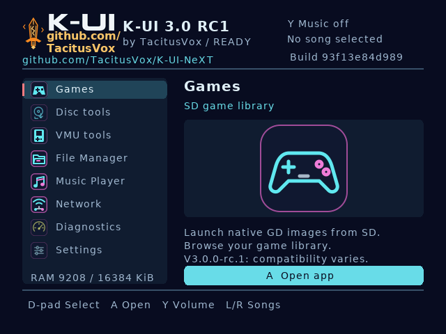
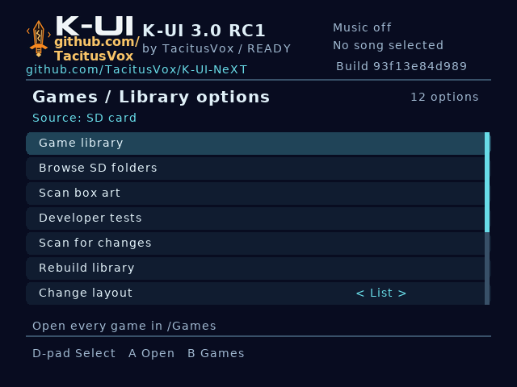
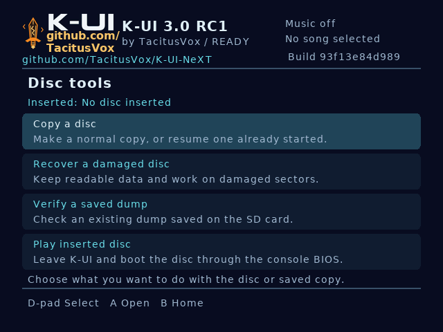
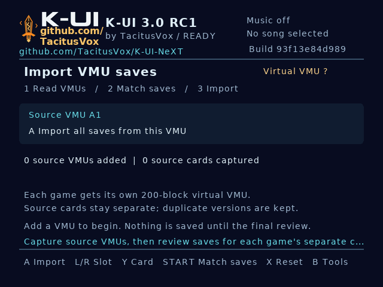

# K-UI 3.0 RC1 “Muramasa”

Muramasa brings native Dreamcast games, Windows CE and Sega Smash Pack into one launcher for consoles using the original GD-ROM drive and SD storage. Since 2.0 Tyrfing, K-UI has gained per-game virtual VMUs, a software updater, selectable themes and a searchable Games library. **The full update is the same build tested on Dreamcast, `93f13e84d989`.**

[Download the SD ZIP](https://github.com/TacitusVox/K-UI-NeXT/releases/download/v3.0.0-rc.1/kui-3.0.0-rc.1-sd.zip) · [Download the full KUP](https://github.com/TacitusVox/K-UI-NeXT/releases/download/v3.0.0-rc.1/kui-3.0.0-rc.1-full.kup) · [Installation guide](https://github.com/TacitusVox/K-UI-NeXT/blob/v3.0.0-rc.1/docs/release-v3.0.0.md) · [Full changelog since 2.0](https://github.com/TacitusVox/K-UI-NeXT/blob/main/docs/changelog-v2.0.0-to-v3.0.0-rc.1.md)

## Release previews

These four screens were captured in Flycast from the published RC1 GUI. Select an image for the full 640 × 480 view.

| Home launcher | Games library options |
| --- | --- |
|  |  |

| Disc tools | Virtual VMU import |
| --- | --- |
|  |  |

## Games, saves and CD music

- **Native games and Smash Pack.** Native games can use the Background reader and per-game virtual VMUs. The Standard VMU reader and all four Smash Pack readers ship with their matching GUI. Favorites, Recently played, search, Flow view and multi-disc grouping make larger libraries easier to browse.
- **Windows CE.** The generic reader gains video-memory transfers and adaptive SCI reads. Dedicated CD-music readers cover 18 additional kernels in the Worms World Party and Bust-A-Move 4 families. **4x4 Evolution plays CD music on Dreamcast.** RC1 also fixes Ducati World’s music repeat count and video-memory reads in the standalone Japanese Virtua Cop 2.
- **Around the console.** K-UI adds themes, menu screenshots and a gallery, virtual-card import and recovery, network media downloads, and damaged-disc recovery.

The hardware check covered the full update, cold boot, game launches, virtual saves and Smash Pack handoffs. Compatibility and performance vary by game. Native Background CD audio and FMV playback are still in development. Five of the newly routed Bust-A-Move 4 family kernels still await hardware reports. [Game compatibility evidence](https://github.com/TacitusVox/K-UI-NeXT/blob/main/docs/accepted-progress.md)

## Installing RC1

**With a current K-UI updater**, copy the full KUP into `KUI/updates/test/`. Open **Settings → Updates**, install it and choose **Restart K-UI**. If you installed the full `93f13e84d989` test package, you already have this release.

**For cold boot, or to upgrade stock 1.7 or 2.0.0**, merge the SD ZIP’s `KUI/` folder into the card root and replace the supplied files. Boot with your independent K-UI disc. The KUP updates the bank used by **Restart K-UI**. The ZIP also updates the physical GUI your disc reads at power-on. Both downloads carry the same 104 managed files.

[Changelog PDF](https://github.com/TacitusVox/K-UI-NeXT/blob/main/docs/releases/3.0.0-rc.1/K-UI-3.0-RC1-Changelog.pdf) · [Hardware test checklist](https://github.com/TacitusVox/K-UI-NeXT/blob/main/docs/releases/3.0.0-rc.1/Hardware-testing.md) · [SHA-256 checksums](https://github.com/TacitusVox/K-UI-NeXT/releases/download/v3.0.0-rc.1/SHA256SUMS.txt)
